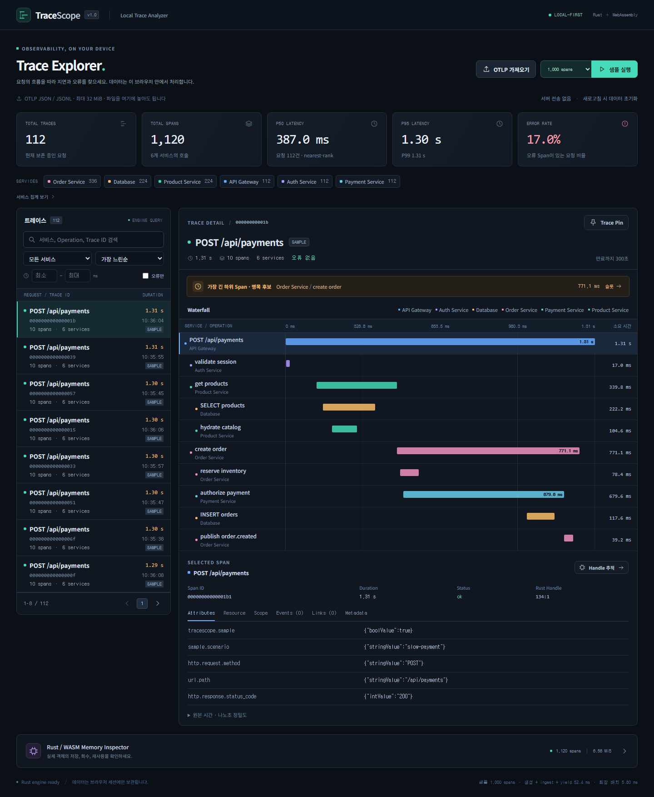
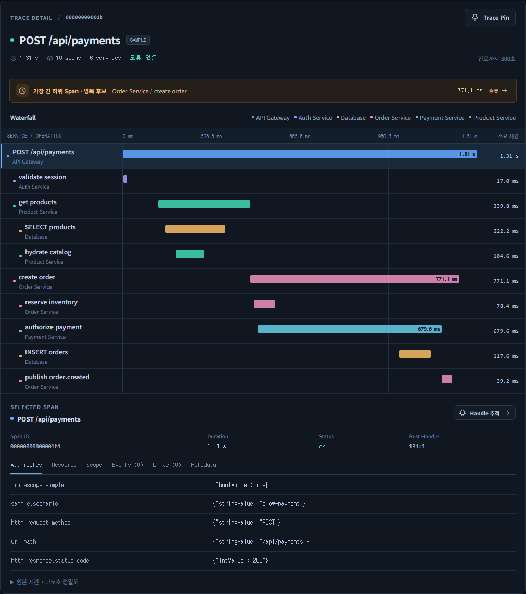
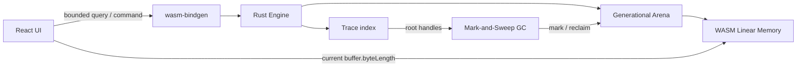
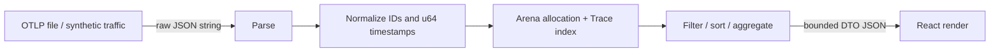
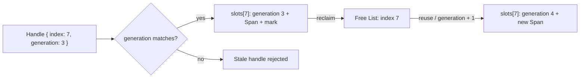
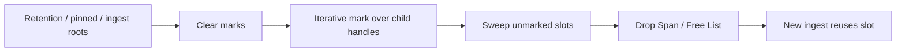
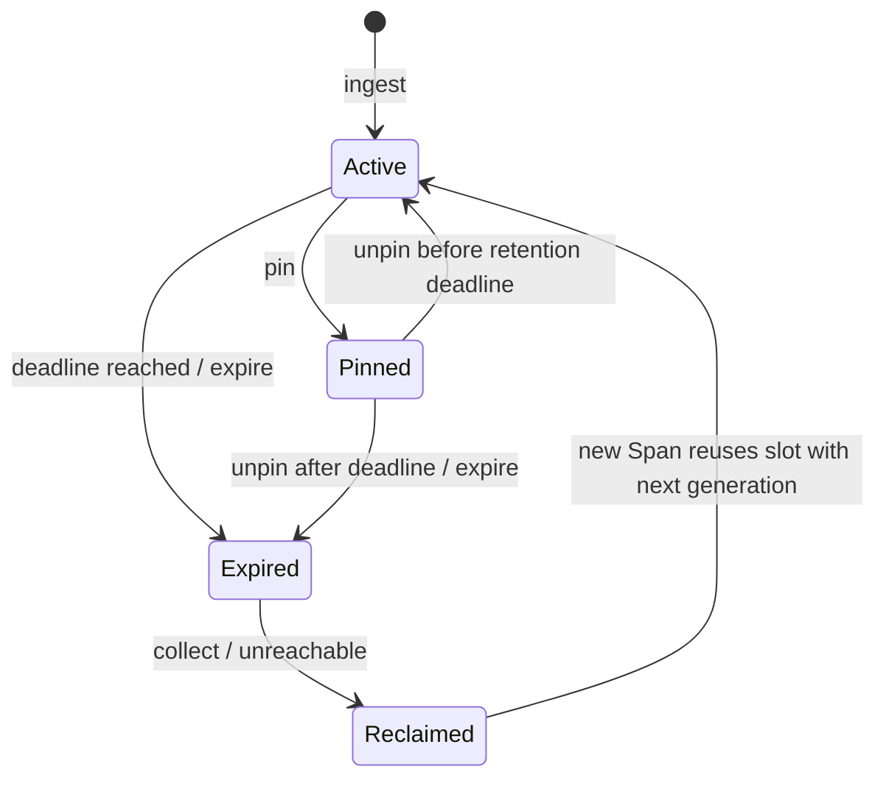
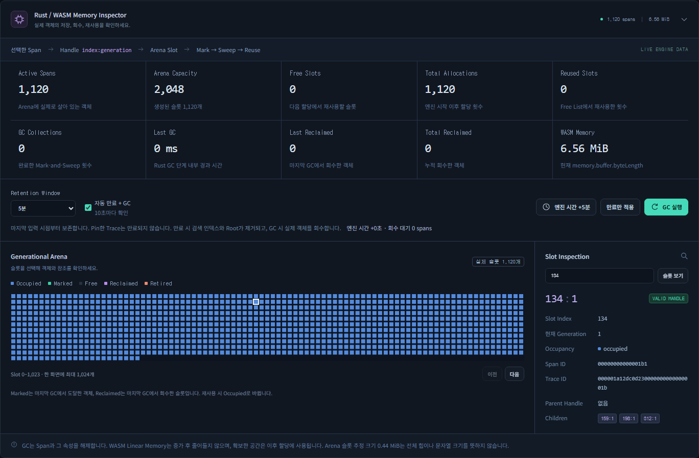
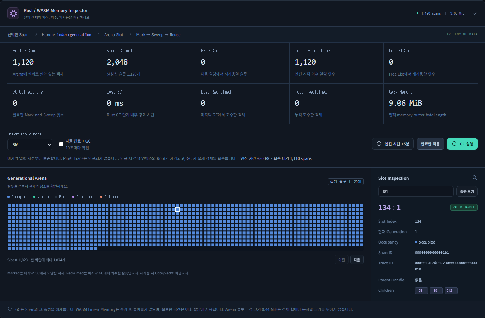
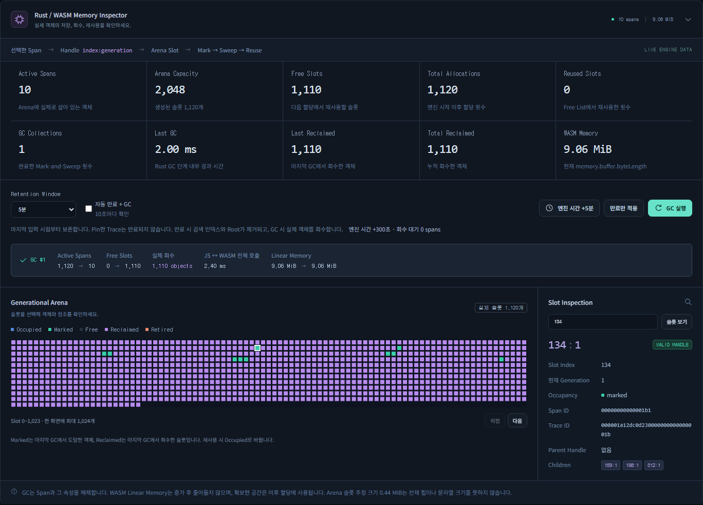

# TraceScope

**브라우저 안에서 트레이스를 가져오고, 느린 호출과 오류의 위치를 확인하는 Local-First Trace Analyzer.**

OTLP JSON 파일을 열거나 내장 샘플 트래픽을 실행하면 서비스와 요청 이름으로 Trace를 찾고 실제 Span 시간으로 그린 Waterfall을 살펴볼 수 있습니다. 데이터는 Rust/WASM 엔진이 소유합니다. 서버로 전송하지 않으며, 새로고침하면 세션 데이터는 사라집니다.

메모리 Inspector를 열면 선택한 Span의 Handle, Arena Slot, 참조 관계와 GC 상태를 확인할 수 있습니다. Pin한 Trace를 남기고 나머지를 만료시킨 뒤 슬롯이 회수되고 재사용되는 과정도 실제 엔진 상태로 관찰합니다.

- [라이브 앱](https://okorion.github.io/tracescope/)
- [GitHub](https://github.com/okorion/tracescope)
- [의존성 선택과 공식 출처](docs/dependencies.md)
- [성능 측정 원본](docs/benchmarks/latest.json)

## 화면과 사용 흐름



1. **OTLP 가져오기**에서 파일을 선택합니다. 첫 화면의 데이터는 합성 샘플이며 실제 측정 데이터가 아닙니다.
2. 서비스·Operation·오류·지연 시간으로 요청을 좁히고 정렬합니다.
3. 요청을 선택해 부모·자식 호출, 오류 Span, 오래 걸린 구간과 Attributes를 확인합니다.
4. 계속 살펴볼 요청은 **Pin**합니다. 보존 기간이 지나도 Pin된 Trace는 유지됩니다.
5. **Memory Inspector**에서 보존 기간과 데모 시간을 조절하고 만료 → GC → 새 샘플 입력을 실행합니다.



Waterfall의 막대 위치는 `(span.start - trace.start) / trace.duration`, 폭은 `span.duration / trace.duration`을 기준으로 합니다. 아주 짧거나 0인 Span도 선택할 수 있도록 최소 표시 폭은 0.25%, 시작 위치 상한은 99.8%로 보정합니다. 수치와 원본 나노초는 실제 값을 유지합니다. 병렬 Span의 시간을 더해 요청 지연이라고 표시하지 않습니다. 가장 긴 하위 Span은 병목 후보이며 인과 관계나 exclusive CPU 시간을 증명하지 않습니다.

## 로컬 실행

Node.js 22.12 이상, Rust 1.99.0, Git이 필요합니다. Node 24를 권장합니다. Rust의 `wasm32-unknown-unknown` target과 native linker도 준비해야 합니다. Windows에서는 Visual Studio Build Tools의 C++ 도구 또는 GNU Rust toolchain을 사용할 수 있습니다.

```sh
git clone https://github.com/okorion/tracescope.git
cd tracescope
npm ci
rustup show
npm run dev
```

`rust-toolchain.toml`이 Rust와 target을 고정합니다. WASM 빌드는 wasm-bindgen 0.2.129 CLI를 `.tools/`에 설치하며 공식 릴리스의 SHA-256을 확인합니다. 해당 바이너리는 Git에 포함하지 않습니다. 브라우저에서 표시된 Vite 주소를 엽니다.

```sh
npm run build
npm run preview
```

프로덕션 산출물은 `web/dist/`입니다. 상대 경로 자산을 사용해 GitHub Pages의 `/tracescope/` 하위 경로에서 동작하며 별도 SPA 라우터는 없습니다.

## 입력 형식과 데이터 정책

기본 형식은 OpenTelemetry의 `ExportTraceServiceRequest` JSON입니다.

```json
{
  "resourceSpans": [{
    "resource": {"attributes": [
      {"key": "service.name", "value": {"stringValue": "checkout"}}
    ]},
    "scopeSpans": [{"spans": [{
      "traceId": "00000000000000000000000000000001",
      "spanId": "0000000000000001",
      "name": "POST /checkout",
      "startTimeUnixNano": "1780000000000000001",
      "endTimeUnixNano": "1780000000120000001",
      "status": {"code": 1}
    }]}]
  }]
}
```

- Trace ID는 32자리, Span ID는 16자리의 0이 아닌 hex입니다. 대소문자는 소문자로 정규화합니다.
- `service.name`은 UTF-8 512 bytes까지 지원합니다. 초과하면 메모리 증폭을 피하기 위해 문서 전체를 명확한 오류로 거부합니다.
- 절대 나노초는 10진수 문자열 또는 정수 JSON 값으로 받아 Rust `u64`로 저장하고 UI에는 문자열로 전달합니다. JSON 원문은 JavaScript에서 먼저 파싱하지 않습니다. 공식 OTLP의 숫자 enum을 지원하며 status code는 0·1·2입니다.
- 여러 Resource와 Scope, 입력 순서가 뒤섞인 부모·자식을 지원합니다. 같은 Trace 안의 중복 Span ID는 먼저 받은 값을 유지하고 개수를 알립니다.
- 부모가 없거나 관계에 순환이 있더라도 유효한 Span을 잃지 않도록 연결 성분의 시작점을 보완합니다. 다른 Trace의 Link는 강한 참조가 아닙니다.
- Span/Resource Attributes, Scope, Events, Links와 추가 메타데이터를 보존합니다. 시간 역전·잘못된 ID 등은 건너뛴 개수와 이유를 반환합니다.
- JSONL은 **비어 있지 않은 한 줄에 완전한 OTLP 요청 하나**입니다. 모든 줄의 문법과 문서 구조를 확인한 뒤 Store를 변경하므로 마지막 줄의 파싱 오류가 앞부분만 반영하지 않습니다.
- 파일 입력은 UTF-8 기준 32 MiB, 활성 Span은 최대 1,000,000개입니다. 한도를 초과하면 분할 입력 또는 GC가 필요합니다. 이 한도는 모든 장치에서 해당 규모의 응답성을 보장하지 않습니다.
- Protobuf, Jaeger JSON, snake_case 구조, 단일 Span JSON은 지원하지 않습니다. 지원하지 않는 형식을 성공으로 표시하지 않습니다.

샘플은 API Gateway, Auth, Product, Order, Payment, Database의 합성 요청입니다. 짧은 호출, 분산 호출, DB 지연, 결제 지연, 오류와 누락된 부모를 포함하며 같은 OTLP 파이프라인으로 들어갑니다. 초기에는 작은 데이터만 만들고 대량 샘플은 사용자가 실행합니다.

## 전체 구조



React는 파일 선택·화면 상태·선택·렌더링을 담당하고 Rust는 정규화·저장·조회·집계·수명을 담당합니다. UI는 Trace 목록의 한 페이지와 선택한 Trace의 제한된 상세만 보유합니다. 원본 전체를 React State에 남기지 않습니다.



파일 원문과 파싱 중간 데이터는 입력 처리 동안 일시적으로 중복될 수 있습니다. 경계는 배치 JSON이며 zero-copy를 주장하지 않습니다. Resource와 Scope는 상세 응답에서 공유 테이블로 한 번만 보내고 JavaScript에서는 같은 객체를 참조합니다. 문자열 복사, Rust 직렬화, JS 파싱 비용도 계측에 포함합니다. 큰 단일 파일 파싱과 GC는 현재 메인 스레드에서 동기 실행합니다.

주요 코드:

| 경로 | 책임 |
|---|---|
| `engine/src/arena.rs` | 세대 핸들, 슬롯, Free List, 재사용과 회수 |
| `engine/src/ingest.rs` | OTLP / JSONL 검증과 정규화 |
| `engine/src/trace.rs` | Span·Trace 모델 |
| `engine/src/store.rs` | 인덱스, 참조 연결, Pin·Retention·GC, monotonic Clock |
| `engine/src/query.rs` | 조회·상세·집계 DTO |
| `engine/src/lib.rs` | 작은 WASM API와 오류 전달 |
| `web/src/engine.ts` | 타입이 지정된 JS↔WASM 어댑터 |
| `web/src/App.tsx` | 화면 상태와 사용자 흐름 |
| `web/src/components/` | Waterfall·Inspector 등 표시 |

## Generational Arena



슬롯을 처음 만들면 Span을 담고, 회수하면 `Option<Span>`을 비우고 index를 Free List에 넣습니다. 새 입력은 Free List를 먼저 사용합니다. 재사용 때 generation이 증가하므로 예전 Handle은 같은 index의 새 객체를 가리킬 수 없습니다. Vec의 재할당도 index 기반 Handle을 바꾸지 않습니다.

잘못된 index·generation과 이중 회수는 실패를 반환하며 Free List를 중복 삽입하지 않습니다. generation이 `u32::MAX`인 슬롯은 회수 시 은퇴시켜 wraparound를 막습니다. 은퇴 슬롯은 Free Slot과 구분합니다. 이 자료구조는 외부 Arena crate에 위임하지 않았습니다.

## GC와 객체 수명



GC는 단일 스레드의 stop-the-world Mark-and-Sweep입니다. 만료되지 않았거나 Pin된 Trace의 Root Handle에서 자식 Handle을 반복형 스택으로 방문합니다. 이미 표시한 객체는 다시 탐색하지 않으므로 순환·중복 참조에 의해 무한 반복하지 않습니다. Mark되지 않은 객체를 실제로 Drop하고 슬롯을 재사용 가능하게 만듭니다.



Retention은 **원본 Span 시간이 아니라 해당 Trace에 새 Span을 마지막으로 수용한 시점**을 기준으로 합니다. 중복 Span만 들어온 입력은 보존 기간을 연장하지 않습니다. 과거에 수집한 OTLP 파일도 가져온 직후 분석할 수 있습니다. 엔진 Clock은 실제 경과 시간과 별도 데모 오프셋을 합치며 OS 시간은 변경하지 않습니다.

마감 시각 도달, `expire`에 의한 조회 인덱스·Root 제거, `collect`에 의한 실제 슬롯 회수는 다른 단계입니다. 만료되어 조회에서 빠진 Span이 아직 Arena에 남으면 Inspector의 pending 수치로 구분합니다. `collect`는 만료 처리를 수행한 뒤 회수합니다. Pin은 만료로부터 Trace를 보호하며 이미 제거된 Trace를 복구하지는 않습니다.

입력·정규화와 GC는 같은 스레드에서 동기 처리되어 중간 입력 상태에 GC가 끼어들지 않습니다. 파싱 중 데이터는 일반 Rust 소유 값이며 Store에 반영된 Trace만 GC 그래프에 포함됩니다. 다른 Trace를 향한 OTLP Link는 식별자 메타데이터이므로 상대 Trace의 수명을 늘리지 않습니다.

## Memory Inspector 읽기



| 값 | 의미 |
|---|---|
| Active Spans | 현재 Arena에 객체가 들어 있는 슬롯 수. 만료 후 Sweep 대기 객체도 포함 |
| Arena Slot Count | 실제 생성된 슬롯 수 |
| Arena Capacity | Vec이 슬롯을 담을 수 있게 확보한 용량 |
| Free Slots | Free List에서 재사용할 수 있는 슬롯 수 |
| Reused Slots | Free Slot에 새 객체를 넣은 누적 횟수 |
| Reclaimed Count | 실제 Span 객체를 회수한 수. 슬롯 배열 축소량이 아님 |
| WASM Linear Memory | 현재 `WebAssembly.Memory.buffer.byteLength`. 엔진 전체 주소 공간 |
| Slot bytes estimate | 슬롯 구조체의 예약 용량 추정. 문자열·인덱스·파싱 메모리 등은 제외 |
| GC Duration | Rust에서 측정한 GC 본체 시간. 별도 전체 호출 시간은 경계 비용 포함 |

Canvas는 전체 슬롯을 DOM으로 만들지 않고 제한된 구간을 그립니다. 선택한 Span → Handle → Slot → 부모·자식 Handle로 연결됩니다. `Marked`는 마지막 완료 GC에서 생존한 occupied 슬롯, `Reclaimed`는 마지막 완료 GC에서 회수되어 아직 재사용되지 않은 슬롯입니다. 실행 중의 GC 애니메이션이나 동시 스냅샷이 아닙니다.




### Rust Ownership과 Custom GC를 함께 쓰는 이유

Rust Ownership은 `Span`, 문자열, Vec 등을 안전하게 할당·해제합니다. 이 제품의 GC는 그 위에서 **어떤 Span을 계속 보존할 것인지** 결정하는 도메인 정책입니다. Rust 전체 힙을 대체하는 allocator나 범용 런타임이 아닙니다.

Trace별로 모두 해제하기만 하면 되는 경우에는 명시적인 삭제나 Trace별 Arena가 더 단순하고 빠를 수 있습니다. 이 구현은 Root와 참조의 도달 가능성을 직접 관찰하고 검증한다는 요구 때문에 Mark-and-Sweep을 사용합니다. 현재처럼 소유권이 Trace 단위로 분리된 그래프에서 Custom GC가 필수라거나 더 빠르다고 주장하지 않습니다.

JavaScript GC는 JavaScript 객체의 도달 가능성을 관리합니다. TraceScope GC는 WASM 안의 Span 슬롯만 관리합니다. Trace 인덱스, 파서 중간 값, 문자열·벡터의 내부 버퍼, WASM 바인딩과 React 상태는 각각 일반 Rust RAII와 JS GC의 책임입니다.

WASM Memory는 페이지 단위로 증가하며 일반적인 `memory.grow`에는 축소 동작이 없습니다. Span을 Drop해도 allocator가 그 공간을 다음 할당에 사용할 뿐 Linear Memory의 byteLength가 즉시 줄어들지 않습니다. Inspector는 항상 새 buffer를 읽으므로 증가 전의 TypedArray를 붙잡지 않습니다.

## 성능과 검증

```sh
npm run test:engine
npm run fmt:check
npm run lint:engine
npm run build
npx playwright install chromium
npm run test:e2e
npm run benchmark
```

벤치마크는 릴리스 WASM을 Chromium의 메인 스레드에서 실행합니다. 1,000 Span씩 입력하고 프레임 사이에 양보합니다. 각 반복에서 새 엔진을 생성하고 Ingest, 21회 Query, Pin·만료·GC, 1,000 슬롯 재사용을 확인합니다. 10,000·100,000 Span을 각각 5회 실행하며 1,000,000은 `BENCH_MILLION=1`에서만 추가합니다.

실측 결과와 실행 환경은 [벤치마크 원본](docs/benchmarks/latest.json)에 기록합니다. Ingest API 시간은 문자열 전송과 보고서 파싱을 포함하고 전체 소요 시간은 샘플 생성·프레임 대기도 포함합니다. frame gap은 배치 시작부터 다음 animation frame까지의 시간이며 사용자 입력 지연의 P95가 아닙니다. 같은 WASM 인스턴스에서 반복하므로 Linear Memory는 앞선 반복의 최고 크기를 유지할 수 있습니다.

2026-10-12, Windows 10 · Ryzen 7 3700X · Chromium 156.0.8078.4 · 릴리스 WASM 실측입니다. 1만·10만은 5회 중앙값, 100만은 **1회 스트레스 실행값**입니다. 동일 PC의 다른 작업을 완전히 격리한 벤치마크 환경은 아닙니다.

| Span 수 | Ingest 호출 합계 | 전체 입력 시간 | Query 중앙값 / P95 | GC | WASM Memory 전 → 후 | 실제 회수 |
|---:|---:|---:|---:|---:|---:|---:|
| 10,000 | 37.7 ms | 159.6 ms | 0.4 / 0.6 ms | 7.7 ms | 26.06 → 26.06 MiB | 9,990 |
| 100,000 | 369.5 ms | 1,654.9 ms | 4.5 / 5.5 ms | 79.3 ms | 235.94 → 235.94 MiB | 99,990 |
| 1,000,000 | 423,654.2 ms | 427,532.3 ms | 115.3 / 127.1 ms | 840.0 ms | 2,280.75 → 2,280.75 MiB | 999,990 |

Query는 실행마다 21회 측정한 중앙값·P95를 구하고, 5회 실행에서는 각각의 중앙값을 표에 표시했습니다. Ingest의 5회 nearest-rank P95는 1만에서 73.5ms, 10만에서 1,612.7ms였으며 5개 표본의 P95는 최댓값이라 안정적인 분포 추정으로 볼 수 없습니다. 모든 실행에서 Pin한 10 Span을 보존하고 후속 입력이 1,000 Free Slot을 재사용하는지 assertion으로 확인했습니다.

1만·10만의 최장 batch→frame 지연은 모든 반복 중 각각 18.7ms·65.2ms였고, 100만에서는 955.4ms였습니다. 100만은 정확성 스트레스 테스트를 통과했지만 대화형 사용에 적합하지 않습니다. 대부분의 시간이 Rust Ingest 내부에서 발생했으며, allocator·인덱스·메모리 증가 중 어느 부분이 급격한 증가를 만들었는지는 별도 프로파일링으로 구분해야 합니다. UI는 샘플을 250 Span씩 처리하지만 단일 파일과 GC에는 같은 수준의 분할이 없습니다.

100만 스트레스를 다시 실행하려면 충분한 메모리와 수 분 이상의 시간을 확보하세요.

```powershell
$env:BENCH_MILLION = '1'
npm run benchmark
Remove-Item Env:BENCH_MILLION
```

Rust와 동등한 JS 저장 엔진을 비교 구현하지 않았으므로 Rust/WASM의 성능 우위는 판정하지 않습니다. 큰 JSON 파싱, 정규화·관계 재구성, 정렬·직렬화, 동기 Sweep이 주 스레드를 점유할 수 있습니다. Worker 도입은 별도 경계 비용과 전송 정책을 측정한 뒤 검토할 대상입니다.

GitHub Actions는 lockfile을 사용해 Rust 테스트·Clippy·형식 검사·WASM/웹 빌드·Chromium E2E를 통과한 `main`만 Pages에 배포합니다. 배포 주소에서도 WASM 로드와 사용자 흐름을 다시 확인합니다.

검증 범위: Rust 테스트 27개, Chromium 기능 테스트 9개, 선택형 캡처 시나리오 1개입니다. 기본 E2E 실행에서 캡처 시나리오가 `skipped`로 표시되는 것은 의도된 설정입니다. `CAPTURE_SCREENSHOTS=1`로 실행하면 Overview·상세·Inspector·GC 전후의 실제 화면을 `docs/screenshots/`에 저장합니다. [모바일 화면](docs/screenshots/mobile.png)도 390×844에서 확인했습니다.

## 현재 범위

- 세션 메모리 기반입니다. IndexedDB 저장, 서버 수집, 로그인, 공유 링크, 여러 사용자의 협업은 없습니다.
- 초기 버전은 메인 스레드에서 동작합니다. 대량 샘플은 배치 처리하지만 단일 OTLP 파일 파싱·GC는 분할하지 않습니다.
- 목록 API는 최대 200 Trace, 상세 API는 최대 2,000 Span, 슬롯 API는 최대 4,096 Slot을 한 번에 반환합니다. UI는 각각 8 Trace, 24 Span, 1,024 Slot씩 페이지를 이동합니다. 상세 Root 참조는 2,000개, 자식 Handle 참조는 256개까지 반환하며 전체 개수는 별도로 표시합니다. 서비스 집계 목록은 Span 수 기준 상위 100개입니다.
- 누락된 부모·오류·긴 Span은 보여주지만 critical path, exclusive duration, 자동 원인 분석은 제공하지 않습니다.
- Percentile은 현재 유지 중인 Trace duration의 nearest-rank 통계입니다. P50은 2개, P95는 20개, P99는 100개 미만이면 값을 숨깁니다. 충분한 개수가 표시되더라도 샘플 데이터의 통계를 운영 SLO로 해석하지 않아야 합니다.
- 외부 네트워크 수집·텔레메트리 업로드를 구현하지 않습니다. 정적 앱 파일을 받은 뒤 입력·조회·분석은 현재 브라우저에서 수행합니다.

MIT License.
